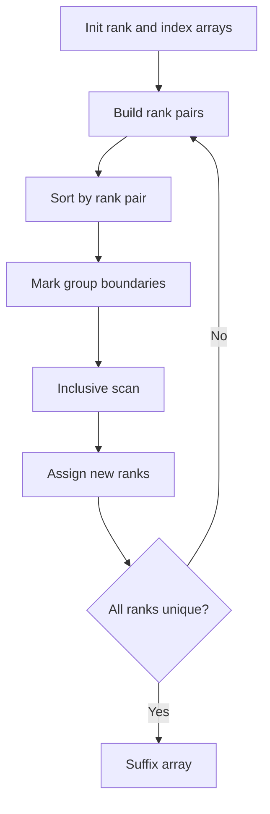
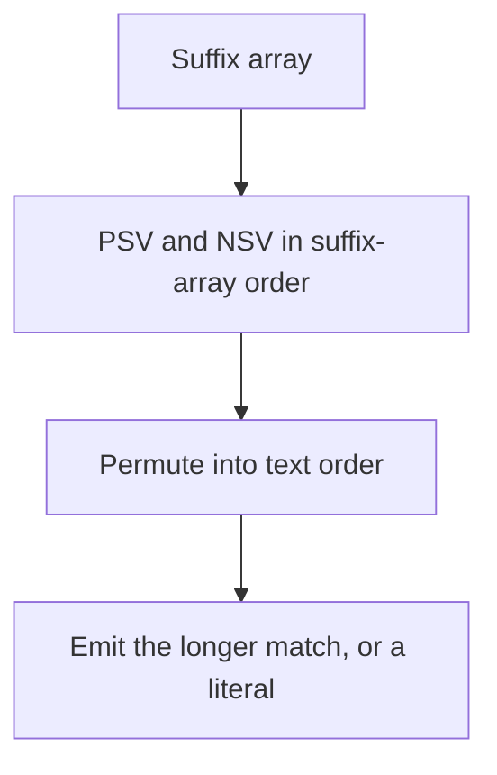

# **GZLZ** — GPU-Accelerated LZ77 Compression


> [!NOTE]
> LZ77 is a lossless compression method that stores each repeated substring as a pointer to an earlier copy. Computing that factorization has stayed mostly single-threaded and in order, which is what limits it on large datasets.

GZLZ computes the LZ77 factorization on a GPU. It builds a suffix array with prefix doubling, finds previous- and next-smaller values, and turns those into factors. Inputs that do not fit in device memory stream through a hybrid CPU–GPU path.

**Paper:** [GZLZ: GPU-Accelerated LZ77 Compression](https://papers.ssrn.com/sol3/papers.cfm?abstract_id=7328580) · DOI: [10.2139/ssrn.7328580](https://doi.org/10.2139/ssrn.7328580)

Rahul Varki, Mohammadali Serajian, Cannon Spencer, Aaron Hong, Oded Green, and Christina Boucher.

---

## Quick start

```bash
git clone https://github.com/cannon-spencer/LZ77GPU.git
cd LZ77GPU
mkdir build && cd build
cmake .. -DCMAKE_BUILD_TYPE=Release
cmake --build . -j$(nproc)

./lz77 <input_file> <output_prefix>
./sa_profiler <input_file>
```

---

## Results

Measured on one NVIDIA B200 (192 GB) with an AMD EPYC 75F3, g++ 12.2.0, and CUDA 12.9. Datasets are nested collections of human chromosome 19 and the [Pizza & Chili repetitive corpus](http://pizzachili.dcc.uchile.cl/repcorpus.html).

### Chromosome 19


| Copies | vs KKP2 | vs PFP-LZ77 | vs SE-KKP                     |
| ------ | ------- | ----------- | ----------------------------- |
| 1–64   | 5–7×    | 11–104×     | 32–59× (1–16), 46–51× (32–64) |
| 128    | 1.2×    | 1.8×        | 9.4×                          |


KKP1 and KKP3 stop at 16 copies. On 1–64 copies, GZLZ uses 1.5–2.6× the peak memory of KKP2. At 128 copies the text exceeds 2³² characters, and GZLZ switches to 64-bit indexes and the hybrid path.

### Pizza & Chili


| Baseline | Speedup  |
| -------- | -------- |
| KKP2     | 5.5–8.8× |
| PFP-LZ77 | 5.2–58×  |
| SE-KKP   | 47–70×   |
| RLE-LZ   | 2.9–7.8× |


These files fit in the 32-bit full-GPU path. Peak memory is 1.7–4.3× KKP2. Wall-clock time and memory plots are in the paper.

---

## Suffix array

A suffix array stores the starting positions of every suffix in lexicographic order. GZLZ builds it with prefix doubling: each round doubles the ranked prefix, sorts the rank pairs, and assigns new ranks until every suffix is unique.

```
String: BANANA

0  A
1  ANA
2  ANANA
3  BANANA
4  NA
5  NANA
```




Ranks are packed into 64-bit keys and sorted with `thrust::sort_by_key`. If the working set does not fit in VRAM, the suffix array is built on the host with [libsais](https://github.com/IlyaGrebnov/libsais) and the rest of the pipeline is streamed.

---

## LZ77

LZ77 replaces a repeated substring with a pointer to an earlier copy. For each position, the longest previous match is the longer of the matches against its previous smaller value (PSV) and next smaller value (NSV) in the suffix array.




Each GPU block scans its suffix-array tile in shared memory. Cross-tile answers use the minimum value of each tile, so tiles that cannot hold a smaller value are skipped. `thrust::scatter` writes PSV and NSV in text order, which avoids storing the inverse suffix array.

The CPU then scans left to right. At each phrase it keeps the longer of the two candidates and writes either a reference `(source, length)` or a literal `(character, 0)`.

---

## Build

CMake 3.18 or newer, C++17, and CUDA. The default architectures are 80, 86, and 90. Add `100` to `CMAKE_CUDA_ARCHITECTURES` to build for the B200.

CMake fetches libdivsufsort, libsais, SDSL-lite, CLI11, malloc_count, spdlog, and Catch2. OpenMP is used for the host suffix array when it is available.

```bash
mkdir build && cd build
cmake .. -DCMAKE_BUILD_TYPE=Release
cmake --build . -j$(nproc)
```

That produces `lz77`, `sa_profiler`, and `tests`.

---

## Usage

```bash
./lz77 <input_file> <output_prefix> [--force-size-t] [--uint40]
./sa_profiler <input_file>
./tests
python3 ../src/Tests/verify_lz77.py <original_file> <output_prefix>_lz77.bin
```

`lz77` reads the file as raw bytes, appends a trailing NUL, and writes `<output_prefix>_lz77.bin`. `--force-size-t` selects 64-bit indexes. `--uint40` packs host arrays on that path.

`sa_profiler` times prefix doubling against libcubwt on one file. `verify_lz77.py` expands the factor file and compares it with the original.

---

## Citation

```bibtex
@article{varki2026gzlz,
  title   = {GZLZ: GPU-Accelerated LZ77 Compression},
  author  = {Varki, Rahul and Serajian, Mohammadali and Spencer, Cannon and Hong, Aaron and Green, Oded and Boucher, Christina},
  journal = {SSRN Electronic Journal},
  year    = {2026},
  doi     = {10.2139/ssrn.7328580},
  url     = {https://doi.org/10.2139/ssrn.7328580}
}
```

